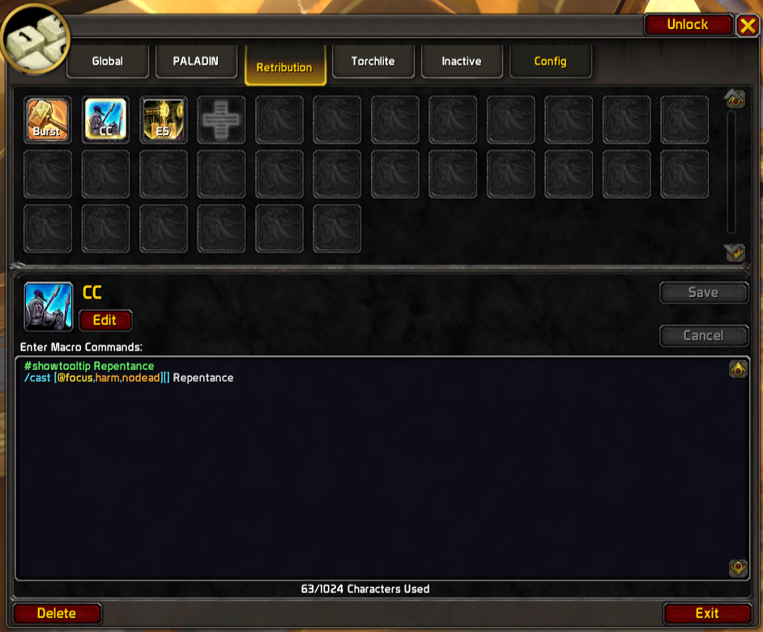

# Mega Macro (a World of Warcraft AddOn)

Use the `/m` command to begin your new macro experience!

Works on Retail and World of Warcraft: Forever.

## What it does

### More macro slots!

This AddOn seamlessly provides you with a massive increase to macro slots over the native amounts of
120 global and 30 per-character slots that the Blizzard UI provides. How does it do this? By segmenting
the 150 total macro slots into 4 categories and hot-switching macros based on your Class and Specialization.

The breakdown of macro slots is as follows:

| Tab        | Slots | Shared with                          |
|------------|-------|--------------------------------------|
| Global     | 60    | every character                      |
| Class      | 30    | every character of that class        |
| Spec       | 30    | every character of that class + spec |
| Character  | 30    | just this character                  |

That's an amazing 60 slots (30 class + 30 spec) you can use to setup your macros for each specialization
where previously you would be forced to fit all your class macros for all specializations into a max of 30
slots!!

I'm not just trying to be a sales person here - I've wanted this feature for ages. Especially as a Druid
main!

On Forever you can put talent points in any tree, so there's no Spec tab. Its 30 slots are added to the class tab,
which holds 60 macros.

### Shared macros across characters

Building on the last feature, the per-class and per-specialization macros are not character specific so
you don't need to copy your macros around manually if you have more than one character of a particular
class.

### Your action bars don't break

Each macro keeps the same game slot for as long as it exists, so switching characters or specs won't
scramble your bars.

### Improved macro UI

The Mega Macro UI replicates the native macro UI down to every last detail **except for the following**
**improvements**:

* Searchable icon list
* A bigger window, so you'll rarely need to scroll.
* Syntax colouring, so commands, targets, conditions and comments are easy to tell apart
* Hover over a condition, target, spell or command to see what it means
* Dynamic fading so you can see what part of the macro would run based on current conditions.
* Buttons are contextually disabled

### Backups and sharing

- Mega Macro backs your macros up once a day at login if anything changed. It keeps daily backups for
  a week, weekly for a month and monthly for six months.
- You can make a backup yourself any time from the Options tab, and restore just the tabs you want.
- **Export Tab** gives you a code for a whole tab that you can paste to a friend (or another account)
  and import.

## Special Thanks

Mega Macro was made by Sellorio. Special thanks to `aurelion314` (`Cubelicious` in-game) and
`Dannez83` for the many hours spent keeping it working since Dragonflight!
